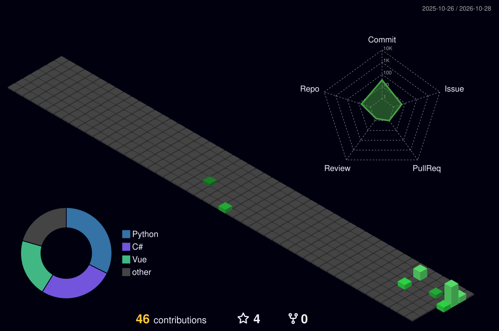

  <!-- 1. 打字机特效 -->
  <a href="https://github.com/xinghuoseo">
    <picture>
      <source media="(prefers-color-scheme: dark)" srcset="https://readme-typing-svg.demolab.com?font=Fira+Code&pause=1000&color=34D399&background=00000000&center=true&vCenter=true&width=435&lines=Hi+there!+I'm+xinghuoseo;Full+Stack+Developer;Open+Source+Enthusiast" />
      <source media="(prefers-color-scheme: light)" srcset="https://readme-typing-svg.demolab.com?font=Fira+Code&pause=1000&color=059669&background=00000000&center=true&vCenter=true&width=435&lines=Hi+there!+I'm+xinghuoseo;Full+Stack+Developer;Open+Source+Enthusiast" />
      
    </picture>
  </a>

  <!-- 2. 状态徽章条 -->
  

    
    
    
  

  <!-- 3. 3D Profile 立体贡献墙 -->
  <picture>
    <source media="(prefers-color-scheme: dark)" srcset="./profile-3d-contrib/profile-night-green.svg" />
    <source media="(prefers-color-scheme: light)" srcset="./profile-3d-contrib/profile-gitblock.svg" />
    
  </picture>

  <!-- 4. 动态活跃折线图 -->
  <picture>
    <source media="(prefers-color-scheme: dark)" srcset="https://github-readme-activity-graph.vercel.app/graph?username=xinghuoseo&theme=react-dark&hide_border=true&bg_color=1f2937&color=34d399&line=34d399&point=6ee7b7&area=true&area_color=065f46" />
    <source media="(prefers-color-scheme: light)" srcset="https://github-readme-activity-graph.vercel.app/graph?username=xinghuoseo&theme=github-light&hide_border=true&color=059669&line=10b981&point=34d399&area=true&area_color=d1fae5" />
    
  </picture>

  <!-- 5. 贪吃蛇贡献图 -->
  <picture>
    <source media="(prefers-color-scheme: dark)" srcset="https://raw.githubusercontent.com/xinghuoseo/xinghuoseo/output/github-contribution-grid-snake-dark.svg" />
    <source media="(prefers-color-scheme: light)" srcset="https://raw.githubusercontent.com/xinghuoseo/xinghuoseo/output/github-contribution-grid-snake.svg" />
    
  </picture>

  <!-- 6. 核心数据统计 & 语言分布 -->
  

    <picture>
      <source media="(prefers-color-scheme: dark)" srcset="https://github-readme-stats.vercel.app/api?username=xinghuoseo&show_icons=true&theme=vue-dark&hide_border=true&include_all_commits=true&locale=cn" />
      <source media="(prefers-color-scheme: light)" srcset="https://github-readme-stats.vercel.app/api?username=xinghuoseo&show_icons=true&theme=default&hide_border=true&include_all_commits=true&locale=cn&text_color=000" />
      
    </picture>
    <picture>
      <source media="(prefers-color-scheme: dark)" srcset="https://github-readme-stats.vercel.app/api/top-langs/?username=xinghuoseo&layout=compact&theme=vue-dark&hide_border=true&locale=cn" />
      <source media="(prefers-color-scheme: light)" srcset="https://github-readme-stats.vercel.app/api/top-langs/?username=xinghuoseo&layout=compact&theme=default&hide_border=true&locale=cn&text_color=000" />
      
    </picture>
  

  <!-- 7. 连续打卡 Streak -->
  <picture>
    <source media="(prefers-color-scheme: dark)" srcset="https://streak-stats.demolab.com?user=xinghuoseo&theme=vue-dark&hide_border=true&locale=zh_Hans" />
    <source media="(prefers-color-scheme: light)" srcset="https://streak-stats.demolab.com?user=xinghuoseo&theme=default&hide_border=true&locale=zh_Hans" />
    
  </picture>

<!-- ================= 技术栈 ================= -->
<h3 align="center">🛠️ Tech Stack & Skills</h3>
<table align="center" style="border: none; background: transparent;">
  <tr>
    <td align="right" width="130"><b>Languages</b></td>
    <td>
      
      
      
      
    </td>
  </tr>
  <tr>
    <td align="right"><b>Tools & Platforms</b></td>
    <td>
      
      
      
      
      
      
    </td>
  </tr>
</table>

<!-- ================= 社交联系 ================= -->

  <h3>📫 Connect with me</h3>
  

    
    &nbsp;
    
  

